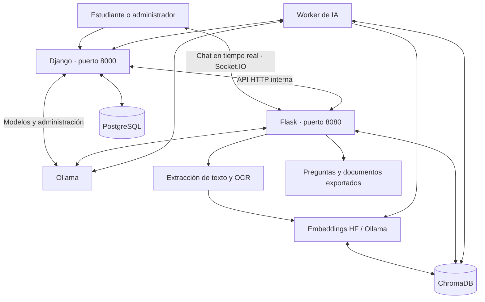

# EduAI 🎓🤖

### Plataforma educativa inteligente para estudiar, conversar y evaluar conocimientos a partir de documentos

[Repositorio en GitHub](https://github.com/blor24/eduai)

**EduAI** es una aplicación web que transforma materiales de estudio en recursos interactivos mediante inteligencia artificial. Permite cargar documentos, realizar preguntas sobre su contenido, generar evaluaciones, guardar preguntas y consultar el progreso de aprendizaje.

El proyecto utiliza **modelos ejecutados localmente con Ollama**, recuperación aumentada por generación (**RAG**) y búsqueda semántica con **ChromaDB**. La aplicación está desarrollada con **Django** y **Flask**, almacena sus datos relacionales en **PostgreSQL** y puede ejecutarse mediante **Docker Compose**.

EduAI v3 también admite **aceleración opcional por GPU NVIDIA**, con un iniciador que selecciona entre el despliegue CPU y GPU según el hardware y el acceso disponible desde Docker. Los **embeddings de Hugging Face** detectan el dispositivo accesible mediante PyTorch; **Ollama** gestiona de forma independiente la ejecución de sus modelos.

> **Estado del proyecto:** versión funcional orientada a desarrollo y uso local. La configuración de Docker Compose incluida no está endurecida para su exposición directa a Internet.

## Contenido

- [Funcionalidades](#-funcionalidades)
- [Tecnologías](#-tecnologías)
- [Arquitectura](#-arquitectura)
- [Estructura del proyecto](#-estructura-del-proyecto)
- [Requisitos](#-requisitos)
- [Instalación con Docker Compose](#-instalación-con-docker-compose)
- [Guía de uso](#-guía-de-uso)
- [Administración de modelos de IA](#-administración-de-modelos-de-ia)
- [Aceleración automática CPU/GPU](#-aceleración-automática-cpugpu)
- [Almacenamiento y persistencia](#-almacenamiento-y-persistencia)
- [Comandos útiles](#-comandos-útiles)
- [Pruebas y resolución de problemas](#-pruebas-y-resolución-de-problemas)
- [Seguridad](#-seguridad)
- [Licencia](#-licencia)

## ✨ Funcionalidades

### Para estudiantes

- **Gestión documental:** carga, visualización y eliminación de archivos `PDF`, `DOCX`, `PPTX`, `TXT`, `MD`, `ODT` y `FODT`.
- **Procesamiento de documentos:** extracción de texto y reconocimiento óptico de caracteres (**OCR**) con Tesseract para contenido escaneado o basado en imágenes.
- **Chat con documentos:** consultas en lenguaje natural utilizando RAG, con selección de documentos y referencias a fragmentos recuperados.
- **Generación de preguntas:** selección múltiple, respuesta corta, completar espacios y emparejamiento.
- **Evaluaciones interactivas:** realización de exámenes, calificación y visualización de resultados.
- **Exportación de actividades:** generación de materiales en **PDF** y **DOCX**.
- **Banco de preguntas:** creación, edición, organización y reutilización de preguntas y exámenes.
- **Seguimiento de actividad:** estadísticas de uso y resultados de estudio.
- **Gestión de cuenta:** autenticación y recuperación de contraseña mediante Django.

### Para administradores

- Administración de usuarios y registros desde **Django Admin**.
- Descarga y eliminación de modelos instalados en **Ollama**.
- Selección del modelo generativo y configuración de parámetros de inferencia.
- Administración de embeddings de **Hugging Face** y **Ollama**.
- Separación de modelos de conversación (`completion`) y modelos de embeddings (`embedding`) según sus capacidades reportadas por Ollama.
- Reindexación de documentos al cambiar el modelo de embeddings, mediante trabajos gestionados por un worker.
- Seguimiento de trabajos y evaluación de recuperación documental con métricas como **Hit@5** y **MRR@5**.
- Guía de administración integrada en la aplicación.
- Diagnóstico de aceleración desde `/admin/ia/`: dispositivo PyTorch del backend y memoria de modelos cargados en Ollama.

## 🛠️ Tecnologías

| Componente | Tecnologías | Responsabilidad |
| --- | --- | --- |
| Aplicación web | Python, **Django 5.1**, HTML, CSS, JavaScript | Usuarios, paneles, vistas, evaluaciones y estadísticas |
| API y chat | **Flask**, **Flask-SocketIO** | Procesamiento de archivos, generación y mensajería en tiempo real |
| Base de datos relacional | **PostgreSQL 17** | Usuarios, mensajes, registros, resultados y configuración de IA |
| Modelos generativos | **Ollama** | Chat contextualizado y generación de preguntas |
| Embeddings | **Hugging Face / Sentence Transformers** y **Ollama** | Representación vectorial de documentos y consultas; selección CPU/GPU de PyTorch para Hugging Face |
| Base de datos vectorial | **ChromaDB** | Indexación, similitud y recuperación semántica |
| Orquestación de IA | **LangChain** | Integración de modelos, prompts y recuperación RAG |
| Procesamiento documental | PyMuPDF, pdfplumber, python-docx, python-pptx, Tesseract OCR | Lectura de texto y reconocimiento de imágenes |
| Exportación | FPDF, python-docx | Generación de actividades descargables |
| Entorno | **Docker y Docker Compose** | Ejecución persistente; configuración CPU y variante NVIDIA GPU |

> Los modelos no están limitados a un único LLM. Por defecto, la configuración del generador utiliza `gemma3:4b`, mientras que el embedding inicial es `sentence-transformers/all-MiniLM-L12-v2`. El administrador puede cambiar los modelos compatibles desde la interfaz.

## 🏗️ Arquitectura



**Carga e indexación:** Django recibe el archivo y lo envía a Flask. Flask extrae el contenido, lo divide en fragmentos, calcula los embeddings y almacena los vectores en ChromaDB. Django registra los metadatos en PostgreSQL. Cuando se usan embeddings de Hugging Face, el backend y el worker seleccionan CPU o GPU de acuerdo con la disponibilidad de PyTorch en cada contenedor.

**Chat RAG:** al realizar una consulta, Flask recupera los fragmentos relevantes del índice vectorial y proporciona ese contexto al modelo de Ollama para generar una respuesta fundamentada en los documentos seleccionados.

**Evaluaciones:** el backend utiliza el contenido documental para generar preguntas y actividades que Django presenta y registra para el usuario.

## 📁 Estructura del proyecto

```text
eduai/
├── backend/
│   ├── eduai-backend.py         # Aplicación Flask y Socket.IO
│   ├── ai_worker.py             # Trabajos de IA en segundo plano
│   ├── eduai/                  # Módulos organizados (si se aplicó la modularización)
│   │   ├── ai/                 # Chat RAG, modelos, generación y detección de GPU
│   │   │   └── device.py       # Selección auto/cpu/cuda/mps y diagnóstico
│   │   ├── api/                # Endpoints y autorización
│   │   ├── documents/          # Procesamiento documental
│   │   └── storage/            # Almacenamiento vectorial
│   ├── tools/                  # Utilidades y evaluaciones
│   ├── font/                   # Fuente utilizada al generar PDF
│   ├── Dockerfile             # Imagen predeterminada con PyTorch para CPU
│   ├── Dockerfile.gpu         # Imagen alternativa con PyTorch CUDA 12.1
│   ├── requirements.docker.txt
│   └── requirements.docker.gpu.txt
├── frontend/
│   ├── Dockerfile
│   └── djtesis/
│       ├── manage.py
│       ├── root/                # Configuración y rutas Django
│       └── tesis/               # Modelos, vistas, admin, plantillas y migraciones
├── docs/                       # Documentación del proyecto
├── compose.yaml                # Servicios Docker Compose y modo CPU
├── compose.gpu.yaml            # Acceso NVIDIA + imágenes de GPU (overlay)
├── iniciar_eduai.sh            # Selección automática de modo CPU/GPU
├── INSTRUCCIONES_GPU.md        # Notas técnicas y reversión del parche
├── .env.example                # Plantilla de configuración
├── .gitignore
├── LICENSE
└── README.md
```

Los archivos de aceleración (`device.py`, `Dockerfile.gpu`, `compose.gpu.yaml`, `iniciar_eduai.sh`, etc.) aparecen **después de aplicar el parche** `actualizar_eduai_gpu.py`. Dicho script se distribuye por separado y no es obligatorio dejarlo dentro del repositorio.

## 📋 Requisitos

- **Docker Engine** con el complemento **Docker Compose**.
- **Git** para clonar el repositorio.
- Conexión a Internet para descargar imágenes Docker, dependencias y modelos.
- Espacio en disco y memoria suficientes para los modelos seleccionados. El consumo depende del LLM y del modelo de embeddings; **CPU sigue siendo la configuración base**.
- Puertos **8000** y **8080** disponibles en el equipo anfitrión.
- **Solo para NVIDIA GPU:** controlador NVIDIA funcional (`nvidia-smi`), **NVIDIA Container Toolkit** y runtime NVIDIA configurado en Docker. La imagen GPU requiere más espacio en disco y utiliza PyTorch con CUDA 12.1.

No es necesario instalar PostgreSQL ni Ollama directamente en el equipo: ambos se ejecutan como servicios de Docker Compose. La GPU **no es obligatoria** y la instalación predeterminada sigue funcionando en CPU.

## 🚀 Instalación con Docker Compose

### 1. Obtener el proyecto

```bash
git clone https://github.com/blor24/eduai.git
cd eduai
```

Si ya tienes el proyecto clonado, simplemente entra en su carpeta.

### 2. Configurar las variables de entorno

```bash
cp .env.example .env
```

Genera valores aleatorios para las variables sensibles:

```bash
python3 -c 'import secrets; print(secrets.token_urlsafe(48))'
```

Edita `.env` y reemplaza los valores de ejemplo, especialmente:

```dotenv
DJANGO_SECRET_KEY=CLAVE_ALEATORIA_LARGA
AI_INTERNAL_TOKEN=OTRO_TOKEN_ALEATORIO
POSTGRES_DB=eduai
POSTGRES_USER=eduai_user
POSTGRES_PASSWORD=CONTRASENA_SEGURA
DJANGO_DEBUG=1
DJANGO_ALLOWED_HOSTS=localhost,127.0.0.1,frontend
```

**No publiques el archivo `.env` en GitHub.** El archivo `.env.example` solo contiene nombres de variables y valores de ejemplo.

### 3. Construir e iniciar los contenedores

**Inicio tradicional (CPU):**

```bash
docker compose config --quiet
docker compose up -d --build
docker compose ps
```

**Inicio con selección automática (si aplicaste la actualización CPU/GPU):**

```bash
chmod +x iniciar_eduai.sh
./iniciar_eduai.sh
```

El iniciador intenta activar el overlay NVIDIA solo cuando detecta una GPU en el host **y** un runtime NVIDIA en Docker; en otros casos inicia la configuración CPU. Consulta [Aceleración automática CPU/GPU](#-aceleración-automática-cpugpu) para requisitos, modos forzados y comandos manuales.

Los servicios definidos son `postgres`, `ollama`, `backend`, `frontend` y `ai_worker`. Al iniciar el frontend se ejecutan las migraciones de Django automáticamente. La primera construcción puede descargar dependencias de aprendizaje automático de tamaño considerable; la imagen GPU requiere descargas adicionales de CUDA.

### 4. Descargar un modelo generativo en Ollama

La configuración inicial de EduAI utiliza `gemma3:4b`:

```bash
docker compose exec ollama ollama pull gemma3:4b
```

El primer modelo de embeddings de Hugging Face se descarga cuando se necesite para procesar documentos. También puedes administrar otros modelos de Ollama desde el panel de administración, incluidos los que ofrecen capacidad de embeddings.

### 5. Crear un administrador

En una instalación nueva, sin datos de usuarios previos:

```bash
docker compose exec frontend python manage.py createsuperuser
```

Si restauraste una base PostgreSQL que ya tiene un superusuario, utiliza esa cuenta; no necesitas crear otra.

### 6. Abrir la aplicación

| Interfaz | Dirección local |
| --- | --- |
| Inicio de EduAI | <http://localhost:8000/> |
| Panel de administración | <http://localhost:8000/admin/> |
| Administración de IA | <http://localhost:8000/admin/ia/> |
| Gestión de modelos Ollama | <http://localhost:8000/admin/ollama/> |
| Guía administrativa | <http://localhost:8000/admin/guia/> |

El backend Flask escucha en el puerto `8080` y se utiliza principalmente mediante la aplicación Django y la comunicación Socket.IO.

## 📖 Guía de uso

1. **Regístrate o inicia sesión** en EduAI.
2. En **Archivos**, sube un documento de estudio y comprueba que figure como **Indexado**.
3. Accede al **Chat**, selecciona uno o varios documentos y formula preguntas sobre su contenido.
4. En **Generar preguntas** o **Examen**, selecciona el documento, los tipos de preguntas y la dificultad.
5. Resuelve las evaluaciones, consulta tus resultados y reutiliza contenido desde el **banco de preguntas**.
6. Consulta **Ayuda** dentro de la plataforma para conocer las opciones disponibles.

## 🧠 Administración de modelos de IA

Accede con una cuenta de superusuario a `/admin/ia/` o `/admin/ollama/`.

**Modelos generativos:** Ollama permite instalar y gestionar diferentes modelos. El chat muestra los modelos instalados que declaran la capacidad `completion`; los modelos exclusivos de embeddings no aparecen como opciones conversacionales.

**Embeddings:** es posible utilizar modelos de Hugging Face o modelos instalados en Ollama que declaren la capacidad `embedding`. La lista de Hugging Face incluye recomendaciones, pero el administrador puede indicar otros repositorios compatibles.

**Reindexación:** cambiar el modelo de embeddings exige reconstruir el índice documental. EduAI gestiona estas operaciones como trabajos del servicio `ai_worker` y registra su progreso. Evita eliminar el modelo o los documentos necesarios durante la reindexación.

**Evaluación de recuperación:** el panel permite utilizar casos de prueba para medir indicadores como Hit@5 y MRR@5.

Consulta también la [guía de administración](docs/GUIA_ADMINISTRACION.md).

## ⚡ Aceleración automática CPU/GPU

No reemplaza el sistema de modelos: conserva las configuraciones elegidas por el administrador, la lógica RAG, los documentos y los índices actuales.

### 1. ¿Qué se ejecuta en CPU y qué puede acelerarse?

| Componente | Modo CPU | Modo NVIDIA GPU |
| --- | --- | --- |
| **Ollama (chat y generación)** | Ollama ejecuta el modelo utilizando CPU | El contenedor recibe acceso a NVIDIA; Ollama determina si puede cargar el modelo en GPU, parcialmente o en CPU |
| **Hugging Face (embeddings)** | Imagen estándar: PyTorch para CPU | Imagen `Dockerfile.gpu` con PyTorch CUDA; `detect_device()` puede seleccionar `cuda` |
| **Embeddings de Ollama** | Procesados por Ollama en CPU | Utilizan la aceleración que Ollama tenga disponible |
| **Django, PostgreSQL, OCR y otras tareas** | Operación habitual en CPU | No se transfieren automáticamente a la GPU |

**Importante:** `EDUAI_ACCELERATOR` elige la configuración de contenedores; `EDUAI_EMBEDDING_DEVICE` selecciona el dispositivo dentro de los procesos Python. Detectar CUDA en Python **no** concede acceso a la GPU: los contenedores deben disponer de controladores, librerías y permisos adecuados.

### 2. Variables de configuración

Agrega estas variables a tu archivo `.env` si quieres configurarlas explícitamente (el script las añade a `.env.example`):

```dotenv
# Selecciona qué stack Docker utilizar al arrancar con iniciar_eduai.sh
EDUAI_ACCELERATOR=auto

# Dispositivo de los embeddings Hugging Face dentro del backend y worker
EDUAI_EMBEDDING_DEVICE=auto
```

| Variable | Valores | Comportamiento |
| --- | --- | --- |
| `EDUAI_ACCELERATOR` | `auto` (predeterminado), `cpu`, `gpu` | Solo lo interpreta `iniciar_eduai.sh`. `auto` selecciona GPU si detecta NVIDIA en el host y runtime NVIDIA de Docker; `cpu` fuerza el Compose base; `gpu` fuerza el overlay NVIDIA. |
| `EDUAI_EMBEDDING_DEVICE` | `auto` (predeterminado), `cpu`, `cuda`, `mps` | Se transmite al backend y al worker. `auto` elige CUDA/ROCm, después MPS si existe, y CPU en último lugar. Forzar `cuda` o `mps` sin disponibilidad real produce un error explícito. |

La opción `mps` corresponde principalmente a PyTorch en entornos Apple compatibles; **el Compose GPU incluido está orientado a NVIDIA**, no configura MPS ni ROCm de AMD. El valor `auto` no instala controladores ni convierte una imagen CPU en una imagen CUDA.

### 3. Iniciar EduAI en el dispositivo disponible

**Automático (recomendado):**

```bash
./iniciar_eduai.sh
```

**Forzar CPU**, por ejemplo para diagnosticar problemas de CUDA:

```bash
EDUAI_ACCELERATOR=cpu ./iniciar_eduai.sh
```

**Forzar NVIDIA GPU** cuando el host y Docker ya estén preparados:

```bash
EDUAI_ACCELERATOR=gpu ./iniciar_eduai.sh
```

También puedes utilizar Docker Compose directamente:

```bash
# Solo CPU
docker compose -f compose.yaml up -d --build

# NVIDIA GPU para Ollama, backend y worker
docker compose -f compose.yaml -f compose.gpu.yaml up -d --build
```

El overlay `compose.gpu.yaml` asigna el dispositivo NVIDIA a **`ollama`**, **`backend`** y **`ai_worker`**, y compila los dos últimos con `backend/Dockerfile.gpu`. Este último instala `torch==2.5.1` desde el índice **CUDA 12.1 (cu121)**. La opción GPU puede utilizar más almacenamiento y memoria, y no garantiza que todos los modelos quepan íntegramente en VRAM.

> Si forzaste `gpu` en un host sin acceso funcional a NVIDIA, es posible que Docker no inicie los servicios. El modo automático utiliza CPU cuando las comprobaciones preliminares de GPU fallan, pero no puede anticipar todas las incompatibilidades de drivers, runtime o memoria.

### 4. Verificar hardware y modelos

Comprueba primero la GPU en el host:

```bash
nvidia-smi
```

Si EduAI está ejecutándose con **Compose CPU**, consulta los dispositivos reconocidos por PyTorch:

```bash
docker compose exec backend python -c \
  "from eduai.ai.device import hardware_info; print(hardware_info())"

docker compose exec ai_worker python -c \
  "from eduai.ai.device import hardware_info; print(hardware_info())"

docker compose exec ollama ollama ps
```

Si se está usando **Compose GPU**, especifica los dos archivos también en los comandos de diagnóstico:

```bash
docker compose -f compose.yaml -f compose.gpu.yaml exec backend \
  python -c "from eduai.ai.device import hardware_info; print(hardware_info())"

docker compose -f compose.yaml -f compose.gpu.yaml exec ai_worker \
  python -c "from eduai.ai.device import hardware_info; print(hardware_info())"

docker compose -f compose.yaml -f compose.gpu.yaml exec ollama ollama ps
```

El objeto `hardware_info()` devuelve información como `requested_device`, `selected_device`, `cuda_available`, `mps_available`, versión de PyTorch y nombre de GPU cuando está disponible. `ollama ps` muestra los modelos **actualmente cargados** y su distribución CPU/GPU; si no hay modelos en memoria, primero utiliza el chat o genera una actividad.

En **`http://localhost:8000/admin/ia/`**, el superusuario puede consultar:

- Dispositivo efectivo y GPU detectada por **PyTorch en el backend**, además de la memoria total identificada.
- Modelos residentes de **Ollama**, modo CPU/GPU aproximado y VRAM ocupada por modelo.
- Advertencias cuando no se puede consultar alguno de esos servicios.

El worker es un proceso independiente; **su dispositivo debe verificarse por separado** con el comando anterior o mediante sus registros. La información de VRAM del panel **no representa la memoria libre total de la GPU**.

### 5. Solución de problemas de aceleración

| Síntoma | Qué revisar |
| --- | --- |
| `selected_device: cpu` pese a tener NVIDIA | Verifica `nvidia-smi`, runtime NVIDIA Docker, uso del overlay `compose.gpu.yaml` y `torch.cuda.is_available()` dentro del contenedor. |
| `CUDA/ROCm no disponible` al forzar `cuda` | Cambia `EDUAI_EMBEDDING_DEVICE=auto` o instala/configura la imagen y GPU compatibles. |
| El iniciador escoge CPU aunque existe NVIDIA | Ejecuta `docker info` y verifica que muestre el runtime `nvidia`; también comprueba `nvidia-smi -L`. |
| Ollama sigue utilizando CPU | Revisa `ollama ps`, compatibilidad del modelo, drivers y VRAM; que PyTorch detecte CUDA no garantiza que Ollama utilice la GPU. |
| Error por VRAM insuficiente (*out of memory*) | Reduce el tamaño/concurrencia de los modelos o usa CPU. El selector automático no cambia de dispositivo durante una inferencia fallida. |
| El panel `/admin/ia/` no muestra hardware | Revisa la conectividad Django → Flask y la variable compartida `AI_INTERNAL_TOKEN`. |
<>
### Consideraciones para AWS y otros despliegues

El overlay GPU anterior se utiliza con **Docker Compose**, no se aplica automáticamente a **ECS/EC2 u otros orquestadores**. En ECS debes utilizar una infraestructura e imagen compatibles con GPU y asignar los recursos GPU a las definiciones de tarea y contenedores correspondientes (Ollama, backend y worker). La detección Python funciona solo cuando el contenedor puede acceder realmente al dispositivo.

## 💾 Almacenamiento y persistencia

Docker Compose utiliza volúmenes persistentes para los datos principales:

| Volumen | Contenido |
| --- | --- |
| `postgres_data` | Base de datos PostgreSQL de Django |
| `ollama_data` | Modelos descargados en Ollama |
| `backend_uploads` | Documentos originales cargados |
| `backend_vectors` | Índices y datos de ChromaDB |
| `hf_cache` | Modelos y archivos de caché de Hugging Face |
| `django_media` | Archivos multimedia del frontend |
| Otros volúmenes | Exportaciones, imágenes de procesamiento y datos auxiliares |

**Importante:** `docker compose down` detiene y retira los contenedores sin borrar los volúmenes nombrados. **No ejecutes `docker compose down -v` si deseas conservar usuarios, documentos, vectores y modelos descargados.**

Para exportar una copia lógica de PostgreSQL:

```bash
mkdir -p respaldos
docker compose exec -T postgres sh -c \
  'pg_dump -U "$POSTGRES_USER" "$POSTGRES_DB"' > respaldos/eduai_postgres.sql
```

Mantén `respaldos/` fuera de Git y recuerda que las copias de PostgreSQL no sustituyen el respaldo de los volúmenes de documentos y ChromaDB.

> Django utiliza **PostgreSQL** cuando se ejecuta con `compose.yaml`. El archivo `settings.py` conserva una alternativa de SQLite para escenarios locales en los que no se define `DB_HOST`.

## ⌨️ Comandos útiles

```bash
# Estado de los servicios
docker compose ps

# Ver registros recientes
docker compose logs --tail=100 frontend backend ai_worker

# Seguir registros en vivo
docker compose logs -f

# Verificar la configuración de Django
docker compose exec frontend python manage.py check

# Ejecutar migraciones manualmente
docker compose exec frontend python manage.py migrate

# Ver modelos de Ollama
docker compose exec ollama ollama list

# Reconstruir tras cambios en el código
docker compose up -d --build frontend backend ai_worker

# Detener sin eliminar los datos
docker compose down
```

## 🧪 Pruebas y resolución de problemas

Pruebas disponibles para los módulos administrativos de Django:

```bash
docker compose exec frontend python manage.py test \
  tesis.test_admin_guide tesis.test_ollama_chat_models
```

**Si no aparecen modelos en el chat:** confirma que Ollama está iniciado, que existe al menos un modelo instalado con capacidad de conversación y revisa `/admin/ollama/`.

**Si un documento aparece sin indexar:** consulta `docker compose logs --tail=150 backend ai_worker` y verifica que ChromaDB y el modelo de embeddings estén disponibles.

**Si Django no inicia:** revisa `docker compose logs frontend postgres`, las variables obligatorias de `.env` y el estado de salud de PostgreSQL.

**Si las preguntas tardan en generarse:** comprueba el estado de Ollama, sus modelos residentes (`ollama ps`) y la disponibilidad de RAM/VRAM. Una GPU puede acelerar la generación, pero solo si Ollama tiene acceso a ella; los embeddings de Hugging Face se configuran por separado.

## 🔒 Seguridad

EduAI está preparado para **desarrollo local**, no para desplegar el archivo Compose directamente en un servidor público. Antes de una publicación en Internet, entre otras medidas:

- Desactiva `DJANGO_DEBUG` y configura `DJANGO_ALLOWED_HOSTS` con los dominios autorizados.
- Utiliza HTTPS, un proxy inverso y un servidor WSGI/ASGI apropiado.
- Restringe el acceso externo a Flask y protege las rutas internas mediante autenticación y segmentación de red.
- Revisa la configuración CORS, cookies, CSRF, límites de carga y manejo de errores.
- Mantén secretos fuera del repositorio y configura respaldos de PostgreSQL, ChromaDB y documentos.
- No publiques el endpoint interno de diagnóstico `/internal/ai/hardware`; requiere el token compartido `AI_INTERNAL_TOKEN` y está destinado a la comunicación Django → Flask.
- Excluye de Git la carpeta de respaldos `.eduai_gpu_backup/` y el `.env` real.
- Actualiza y revisa periódicamente las dependencias.

Los documentos pueden contener información privada: **no subas archivos de usuarios, respaldos de bases de datos, modelos descargados ni credenciales a GitHub**.

## 🤝 Contribuciones

Las contribuciones y propuestas de mejora son bienvenidas. Puedes abrir un *issue* para reportar problemas o proponer funcionalidades, y enviar un *pull request* con los cambios explicados y, cuando corresponda, pruebas.

## 📄 Licencia

Este proyecto se distribuye bajo la **GNU Affero General Public License v3.0 (AGPL-3.0)**. Consulta el archivo [LICENSE](LICENSE) para conocer sus términos.

---

<p align="center"><strong>EduAI — Aprende y evalúa tus conocimientos con el apoyo de inteligencia artificial.</strong></p>