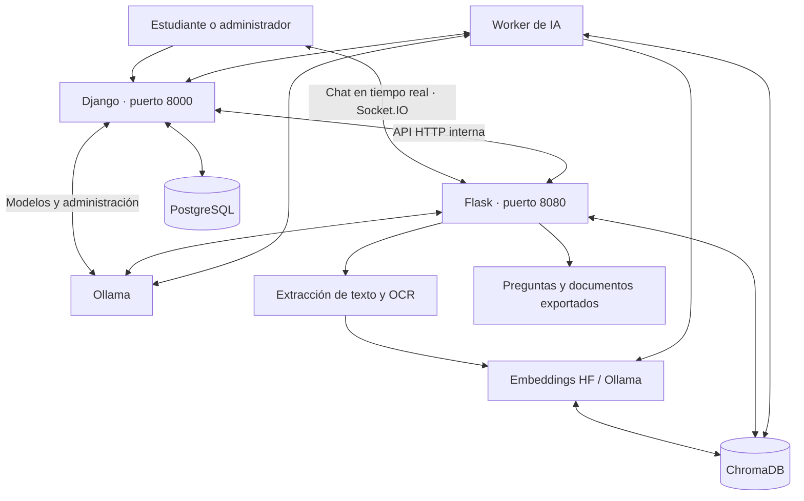

# EduAI 🎓🤖

### Plataforma educativa inteligente para estudiar, conversar y evaluar conocimientos a partir de documentos

[Repositorio en GitHub](https://github.com/blor24/eduai)

**EduAI** es una aplicación web que transforma materiales de estudio en recursos interactivos mediante inteligencia artificial. Permite cargar documentos, realizar preguntas sobre su contenido, generar evaluaciones, guardar preguntas y consultar el progreso de aprendizaje.

El proyecto utiliza **modelos ejecutados localmente con Ollama**, recuperación aumentada por generación (**RAG**) y búsqueda semántica con **ChromaDB**. La aplicación está desarrollada con **Django** y **Flask**, almacena sus datos relacionales en **PostgreSQL** y puede ejecutarse mediante **Docker Compose**.

> **Estado del proyecto:** versión funcional orientada a desarrollo y uso local. La configuración de Docker Compose incluida no está endurecida para su exposición directa a Internet.

## Contenido

- [Funcionalidades](#-funcionalidades)
- [Tecnologías](#-tecnologías)
- [Arquitectura](#-arquitectura)
- [Estructura del proyecto](#-estructura-del-proyecto)
- [Requisitos](#-requisitos)
- [Instalación con Docker Compose](#-instalación-con-docker-compose)
- [Guía de uso](#-guía-de-uso)
- [Administración de modelos de IA](#-administración-de-modelos-de-ia)
- [Almacenamiento y persistencia](#-almacenamiento-y-persistencia)
- [Comandos útiles](#-comandos-útiles)
- [Pruebas y resolución de problemas](#-pruebas-y-resolución-de-problemas)
- [Seguridad](#-seguridad)
- [Licencia](#-licencia)

## ✨ Funcionalidades

### Para estudiantes

- **Gestión documental:** carga, visualización y eliminación de archivos `PDF`, `DOCX`, `PPTX`, `TXT`, `MD`, `ODT` y `FODT`.
- **Procesamiento de documentos:** extracción de texto y reconocimiento óptico de caracteres (**OCR**) con Tesseract para contenido escaneado o basado en imágenes.
- **Chat con documentos:** consultas en lenguaje natural utilizando RAG, con selección de documentos y referencias a fragmentos recuperados.
- **Generación de preguntas:** selección múltiple, respuesta corta, completar espacios y emparejamiento.
- **Evaluaciones interactivas:** realización de exámenes, calificación y visualización de resultados.
- **Exportación de actividades:** generación de materiales en **PDF** y **DOCX**.
- **Banco de preguntas:** creación, edición, organización y reutilización de preguntas y exámenes.
- **Seguimiento de actividad:** estadísticas de uso y resultados de estudio.
- **Gestión de cuenta:** autenticación y recuperación de contraseña mediante Django.

### Para administradores

- Administración de usuarios y registros desde **Django Admin**.
- Descarga y eliminación de modelos instalados en **Ollama**.
- Selección del modelo generativo y configuración de parámetros de inferencia.
- Administración de embeddings de **Hugging Face** y **Ollama**.
- Separación de modelos de conversación (`completion`) y modelos de embeddings (`embedding`) según sus capacidades reportadas por Ollama.
- Reindexación de documentos al cambiar el modelo de embeddings, mediante trabajos gestionados por un worker.
- Seguimiento de trabajos y evaluación de recuperación documental con métricas como **Hit@5** y **MRR@5**.
- Guía de administración integrada en la aplicación.

## 🛠️ Tecnologías

| Componente | Tecnologías | Responsabilidad |
| --- | --- | --- |
| Aplicación web | Python, **Django 5.1**, HTML, CSS, JavaScript | Usuarios, paneles, vistas, evaluaciones y estadísticas |
| API y chat | **Flask**, **Flask-SocketIO** | Procesamiento de archivos, generación y mensajería en tiempo real |
| Base de datos relacional | **PostgreSQL 17** | Usuarios, mensajes, registros, resultados y configuración de IA |
| Modelos generativos | **Ollama** | Chat contextualizado y generación de preguntas |
| Embeddings | **Hugging Face / Sentence Transformers** y **Ollama** | Representación vectorial de documentos y consultas |
| Base de datos vectorial | **ChromaDB** | Indexación, similitud y recuperación semántica |
| Orquestación de IA | **LangChain** | Integración de modelos, prompts y recuperación RAG |
| Procesamiento documental | PyMuPDF, pdfplumber, python-docx, python-pptx, Tesseract OCR | Lectura de texto y reconocimiento de imágenes |
| Exportación | FPDF, python-docx | Generación de actividades descargables |
| Entorno | **Docker y Docker Compose** | Ejecución de servicios y almacenamiento persistente |

> Los modelos no están limitados a un único LLM. Por defecto, la configuración del generador utiliza `gemma3:4b`, mientras que el embedding inicial es `sentence-transformers/all-MiniLM-L12-v2`. El administrador puede cambiar los modelos compatibles desde la interfaz.

## 🏗️ Arquitectura



**Carga e indexación:** Django recibe el archivo y lo envía a Flask. Flask extrae el contenido, lo divide en fragmentos, calcula los embeddings y almacena los vectores en ChromaDB. Django registra los metadatos en PostgreSQL.

**Chat RAG:** al realizar una consulta, Flask recupera los fragmentos relevantes del índice vectorial y proporciona ese contexto al modelo de Ollama para generar una respuesta fundamentada en los documentos seleccionados.

**Evaluaciones:** el backend utiliza el contenido documental para generar preguntas y actividades que Django presenta y registra para el usuario.

## 📁 Estructura del proyecto

```text
eduai/
├── backend/
│   ├── eduai-backend.py         # Aplicación Flask y Socket.IO
│   ├── ai_worker.py             # Trabajos de IA en segundo plano
│   ├── eduai/                  # Módulos organizados (si se aplicó la modularización)
│   │   ├── ai/                 # Chat RAG, modelos y generación
│   │   ├── api/                # Endpoints y autorización
│   │   ├── documents/          # Procesamiento documental
│   │   └── storage/            # Almacenamiento vectorial
│   ├── tools/                  # Utilidades y evaluaciones
│   ├── font/                   # Fuente utilizada al generar PDF
│   ├── Dockerfile
│   └── requirements.docker.txt
├── frontend/
│   ├── Dockerfile
│   └── djtesis/
│       ├── manage.py
│       ├── root/                # Configuración y rutas Django
│       └── tesis/               # Modelos, vistas, admin, plantillas y migraciones
├── docs/                       # Documentación del proyecto
├── compose.yaml                # Servicios Docker Compose
├── .env.example                # Plantilla de configuración
├── .gitignore
├── LICENSE
└── README.md
```

> Si no se ejecutó la opción de modularización del script de limpieza, algunos módulos Python continúan directamente en `backend/`. Los puntos de entrada y los comandos Docker siguen siendo los mismos.

## 📋 Requisitos

- **Docker Engine** con el complemento **Docker Compose**.
- **Git** para clonar el repositorio.
- Conexión a Internet para descargar imágenes Docker, dependencias y modelos.
- Espacio en disco y memoria suficientes para los modelos seleccionados. El consumo depende del LLM y del modelo de embeddings; la configuración incluida utiliza PyTorch para CPU en el backend.
- Puertos **8000** y **8080** disponibles en el equipo anfitrión.

No es necesario instalar PostgreSQL ni Ollama directamente en el equipo: ambos se ejecutan como servicios de Docker Compose.

## 🚀 Instalación con Docker Compose

### 1. Obtener el proyecto

```bash
git clone https://github.com/blor24/eduai.git
cd eduai
```

Si ya tienes el proyecto clonado, simplemente entra en su carpeta.

### 2. Configurar las variables de entorno

```bash
cp .env.example .env
```

Genera valores aleatorios para las variables sensibles:

```bash
python3 -c 'import secrets; print(secrets.token_urlsafe(48))'
```

Edita `.env` y reemplaza los valores de ejemplo, especialmente:

```dotenv
DJANGO_SECRET_KEY=CLAVE_ALEATORIA_LARGA
AI_INTERNAL_TOKEN=OTRO_TOKEN_ALEATORIO
POSTGRES_DB=eduai
POSTGRES_USER=eduai_user
POSTGRES_PASSWORD=CONTRASENA_SEGURA
DJANGO_DEBUG=1
DJANGO_ALLOWED_HOSTS=localhost,127.0.0.1,frontend
```

**No publiques el archivo `.env` en GitHub.** El archivo `.env.example` solo contiene nombres de variables y valores de ejemplo.

### 3. Construir e iniciar los contenedores

```bash
docker compose config --quiet
docker compose up -d --build
docker compose ps
```

Los servicios definidos son `postgres`, `ollama`, `backend`, `frontend` y `ai_worker`. Al iniciar el frontend se ejecutan las migraciones de Django automáticamente. La primera construcción puede descargar dependencias de aprendizaje automático de tamaño considerable.

### 4. Descargar un modelo generativo en Ollama

La configuración inicial de EduAI utiliza `gemma3:4b`:

```bash
docker compose exec ollama ollama pull gemma3:4b
```

El primer modelo de embeddings de Hugging Face se descarga cuando se necesite para procesar documentos. También puedes administrar otros modelos de Ollama desde el panel de administración, incluidos los que ofrecen capacidad de embeddings.

### 5. Crear un administrador

En una instalación nueva, sin datos de usuarios previos:

```bash
docker compose exec frontend python manage.py createsuperuser
```

Si restauraste una base PostgreSQL que ya tiene un superusuario, utiliza esa cuenta; no necesitas crear otra.

### 6. Abrir la aplicación

| Interfaz | Dirección local |
| --- | --- |
| Inicio de EduAI | <http://localhost:8000/> |
| Panel de administración | <http://localhost:8000/admin/> |
| Administración de IA | <http://localhost:8000/admin/ia/> |
| Gestión de modelos Ollama | <http://localhost:8000/admin/ollama/> |
| Guía administrativa | <http://localhost:8000/admin/guia/> |

El backend Flask escucha en el puerto `8080` y se utiliza principalmente mediante la aplicación Django y la comunicación Socket.IO.

## 📖 Guía de uso

1. **Regístrate o inicia sesión** en EduAI.
2. En **Archivos**, sube un documento de estudio y comprueba que figure como **Indexado**.
3. Accede al **Chat**, selecciona uno o varios documentos y formula preguntas sobre su contenido.
4. En **Generar preguntas** o **Examen**, selecciona el documento, los tipos de preguntas y la dificultad.
5. Resuelve las evaluaciones, consulta tus resultados y reutiliza contenido desde el **banco de preguntas**.
6. Consulta **Ayuda** dentro de la plataforma para conocer las opciones disponibles.

## 🧠 Administración de modelos de IA

Accede con una cuenta de superusuario a `/admin/ia/` o `/admin/ollama/`.

**Modelos generativos:** Ollama permite instalar y gestionar diferentes modelos. El chat muestra los modelos instalados que declaran la capacidad `completion`; los modelos exclusivos de embeddings no aparecen como opciones conversacionales.

**Embeddings:** es posible utilizar modelos de Hugging Face o modelos instalados en Ollama que declaren la capacidad `embedding`. La lista de Hugging Face incluye recomendaciones, pero el administrador puede indicar otros repositorios compatibles.

**Reindexación:** cambiar el modelo de embeddings exige reconstruir el índice documental. EduAI gestiona estas operaciones como trabajos del servicio `ai_worker` y registra su progreso. Evita eliminar el modelo o los documentos necesarios durante la reindexación.

**Evaluación de recuperación:** el panel permite utilizar casos de prueba para medir indicadores como Hit@5 y MRR@5.

Consulta también la [guía de administración](docs/GUIA_ADMINISTRACION.md).

## 💾 Almacenamiento y persistencia

Docker Compose utiliza volúmenes persistentes para los datos principales:

| Volumen | Contenido |
| --- | --- |
| `postgres_data` | Base de datos PostgreSQL de Django |
| `ollama_data` | Modelos descargados en Ollama |
| `backend_uploads` | Documentos originales cargados |
| `backend_vectors` | Índices y datos de ChromaDB |
| `hf_cache` | Modelos y archivos de caché de Hugging Face |
| `django_media` | Archivos multimedia del frontend |
| Otros volúmenes | Exportaciones, imágenes de procesamiento y datos auxiliares |

**Importante:** `docker compose down` detiene y retira los contenedores sin borrar los volúmenes nombrados. **No ejecutes `docker compose down -v` si deseas conservar usuarios, documentos, vectores y modelos descargados.**

Para exportar una copia lógica de PostgreSQL:

```bash
mkdir -p respaldos
docker compose exec -T postgres sh -c \
  'pg_dump -U "$POSTGRES_USER" "$POSTGRES_DB"' > respaldos/eduai_postgres.sql
```

Mantén `respaldos/` fuera de Git y recuerda que las copias de PostgreSQL no sustituyen el respaldo de los volúmenes de documentos y ChromaDB.

> Django utiliza **PostgreSQL** cuando se ejecuta con `compose.yaml`. El archivo `settings.py` conserva una alternativa de SQLite para escenarios locales en los que no se define `DB_HOST`.

## ⌨️ Comandos útiles

```bash
# Estado de los servicios
docker compose ps

# Ver registros recientes
docker compose logs --tail=100 frontend backend ai_worker

# Seguir registros en vivo
docker compose logs -f

# Verificar la configuración de Django
docker compose exec frontend python manage.py check

# Ejecutar migraciones manualmente
docker compose exec frontend python manage.py migrate

# Ver modelos de Ollama
docker compose exec ollama ollama list

# Reconstruir tras cambios en el código
docker compose up -d --build frontend backend ai_worker

# Detener sin eliminar los datos
docker compose down
```

## 🧪 Pruebas y resolución de problemas

Pruebas disponibles para los módulos administrativos de Django:

```bash
docker compose exec frontend python manage.py test \
  tesis.test_admin_guide tesis.test_ollama_chat_models
```

**Si no aparecen modelos en el chat:** confirma que Ollama está iniciado, que existe al menos un modelo instalado con capacidad de conversación y revisa `/admin/ollama/`.

**Si un documento aparece sin indexar:** consulta `docker compose logs --tail=150 backend ai_worker` y verifica que ChromaDB y el modelo de embeddings estén disponibles.

**Si Django no inicia:** revisa `docker compose logs frontend postgres`, las variables obligatorias de `.env` y el estado de salud de PostgreSQL.

**Si las preguntas tardan en generarse:** comprueba el estado de Ollama y considera elegir un modelo compatible con la memoria y CPU disponibles.

## 🔒 Seguridad

EduAI está preparado para **desarrollo local**, no para desplegar el archivo Compose directamente en un servidor público. Antes de una publicación en Internet, entre otras medidas:

- Desactiva `DJANGO_DEBUG` y configura `DJANGO_ALLOWED_HOSTS` con los dominios autorizados.
- Utiliza HTTPS, un proxy inverso y un servidor WSGI/ASGI apropiado.
- Restringe el acceso externo a Flask y protege las rutas internas mediante autenticación y segmentación de red.
- Revisa la configuración CORS, cookies, CSRF, límites de carga y manejo de errores.
- Mantén secretos fuera del repositorio y configura respaldos de PostgreSQL, ChromaDB y documentos.
- Actualiza y revisa periódicamente las dependencias.

Los documentos pueden contener información privada: **no subas archivos de usuarios, respaldos de bases de datos, modelos descargados ni credenciales a GitHub**.

## 🤝 Contribuciones

Las contribuciones y propuestas de mejora son bienvenidas. Puedes abrir un *issue* para reportar problemas o proponer funcionalidades, y enviar un *pull request* con los cambios explicados y, cuando corresponda, pruebas.

## 📄 Licencia

Este proyecto se distribuye bajo la **GNU Affero General Public License v3.0 (AGPL-3.0)**. Consulta el archivo [LICENSE](LICENSE) para conocer sus términos.

---

<p align="center"><strong>EduAI — Aprende y evalúa tus conocimientos con el apoyo de inteligencia artificial.</strong></p>
