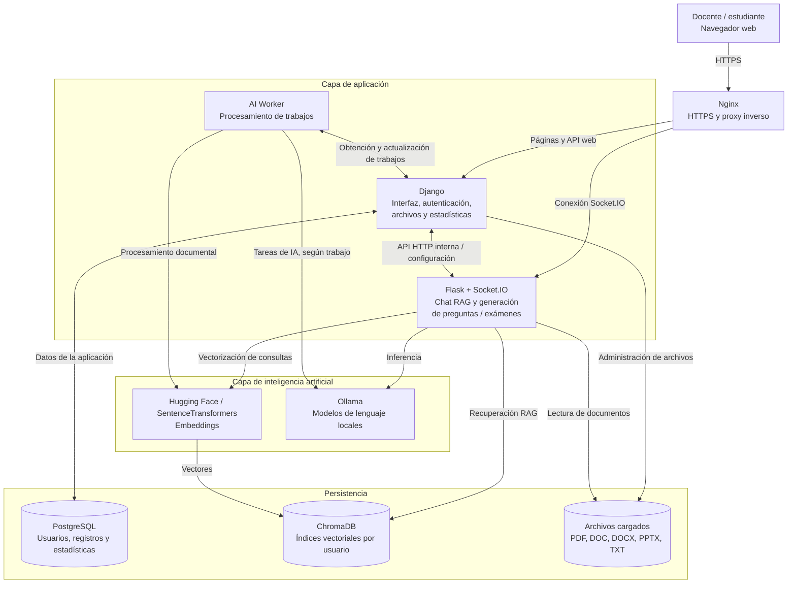
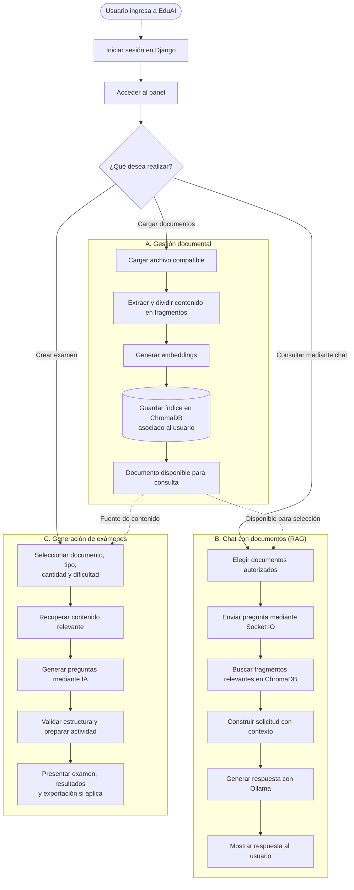
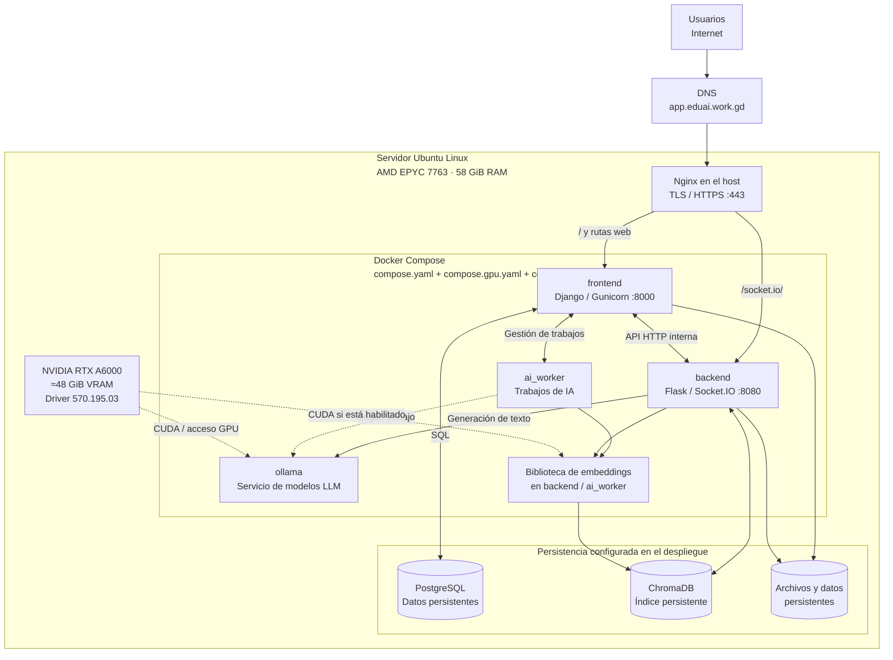

# Diagramas de arquitectura y funcionamiento de EduAI

> Diagramas en **Mermaid** para visualizar directamente en archivos Markdown (`.md`) compatibles con GitHub. Representan la arquitectura funcional y el despliegue descritos en la documentación del proyecto. Los nombres exactos de volúmenes, redes y algunas rutas internas deben contrastarse con los archivos `compose.yaml`, `compose.gpu.yaml`, `compose.prod.yaml` y la configuración vigente de Nginx.

## 1. Arquitectura del proyecto

Este diagrama presenta las capas de interfaz, lógica de aplicación, procesamiento de inteligencia artificial y almacenamiento. **ChromaDB** es el índice vectorial persistente utilizado por los procesos de IA; no se representa necesariamente como un contenedor independiente.

## 2. Cómo funciona la aplicación

Este flujo describe las tres operaciones centrales: cargar e indexar documentos, conversar con un documento mediante recuperación aumentada (RAG), y generar actividades o exámenes. La aplicación también puede registrar resultados y ofrecer exportaciones según la funcionalidad utilizada.

## 3. Despliegue en el servidor con GPU

La aplicación se expone en **`https://app.eduai.work.gd`** mediante Nginx y HTTPS. La pila utiliza Docker Compose con archivos base, GPU y producción. La aceleración se proporciona mediante la **NVIDIA RTX A6000**; el uso efectivo de CUDA depende de los permisos del contenedor, el runtime y el dispositivo configurado para cada proceso.

### Notas para el README

- **Servicios de la aplicación:** `frontend` (Django), `backend` (Flask y Socket.IO), `ai_worker` y `ollama`.
- **Datos:** PostgreSQL almacena registros de aplicación; ChromaDB persiste vectores para búsqueda semántica, y los archivos cargados se conservan en almacenamiento persistente.
- **Proxy y seguridad:** Nginx termina HTTPS y enruta el tráfico hacia los componentes correspondientes.
- **GPU:** NVIDIA RTX A6000 (aprox. 48 GiB de memoria gráfica). El comando `nvidia-smi` mostraba CUDA 12.8 como versión admitida por el controlador, no necesariamente la versión del toolkit instalada en cada contenedor.
- **Alcance:** diagramas de alto nivel. La ubicación exacta de PostgreSQL y los montajes de ChromaDB/archivos debe validarse con la configuración desplegada; no implican que cada componente de persistencia sea un contenedor separado.
